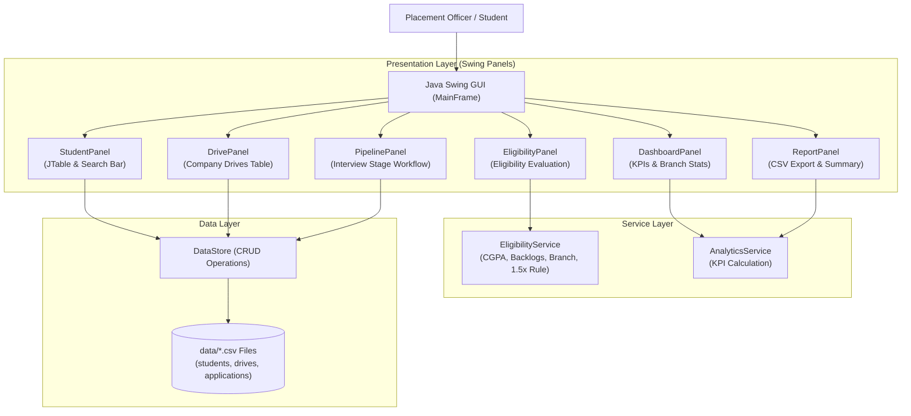
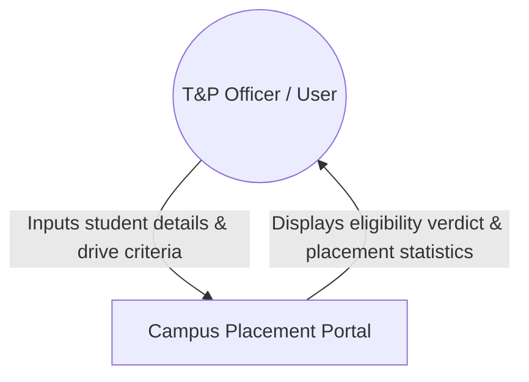
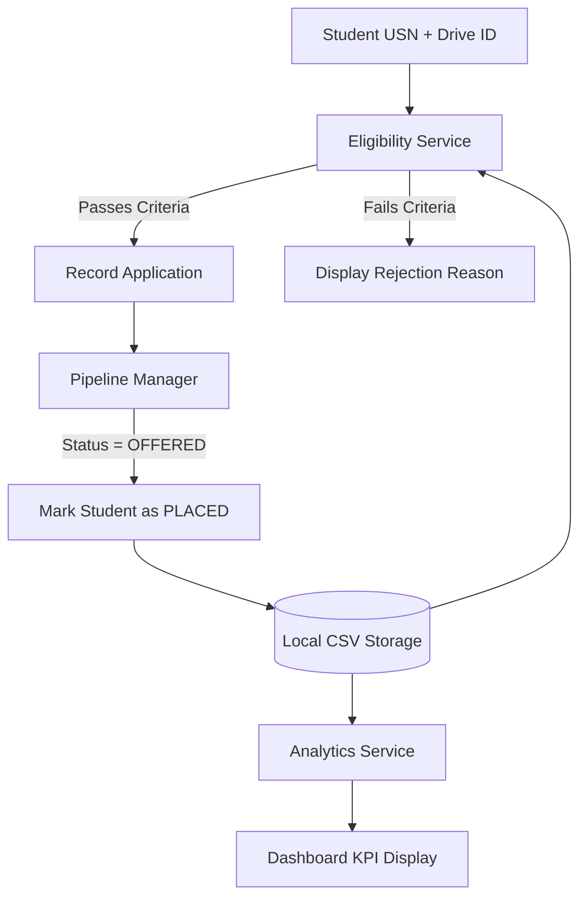
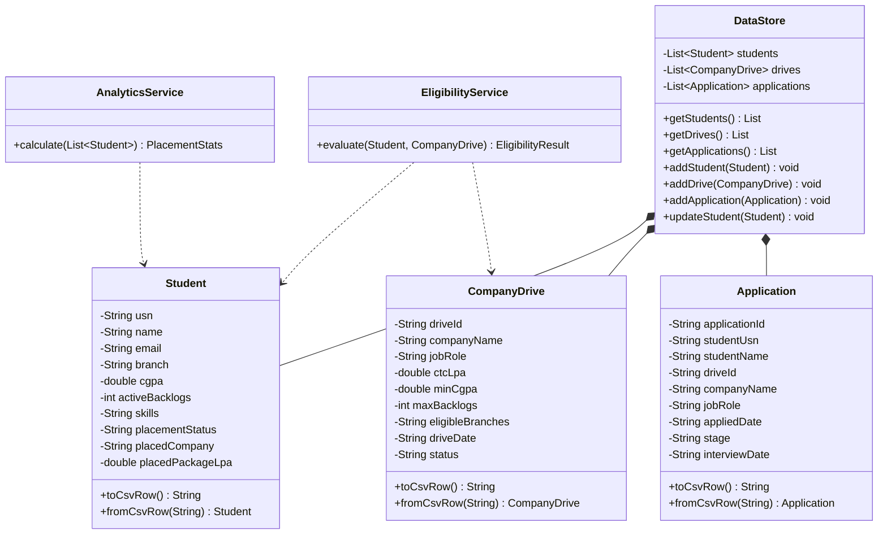

# A MINI PROJECT REPORT ON
# **Campus Placement Drive & Job Application Portal**

*Submitted in partial fulfillment of the requirements for the award of the degree of*  
**BACHELOR OF TECHNOLOGY**  
*in*  
**COMPUTER SCIENCE AND ENGINEERING**

---

### **Submitted By:**
1. **Student 1 (Team Lead):** Kshitij Jangam — *Roll No / USN: [USN-01]*  
   *(Module 1: Student & Company Profile Management)*
2. **Student 2:** [Student 2 Name] — *Roll No / USN: [USN-02]*  
   *(Module 2: Automated Eligibility & Criteria Engine)*
3. **Student 3:** [Student 3 Name] — *Roll No / USN: [USN-03]*  
   *(Module 3: Application Pipeline & Interview Tracker)*
4. **Student 4:** [Student 4 Name] — *Roll No / USN: [USN-04]*  
   *(Module 4: Swing GUI Integration & Analytics Reporting)*

**Under the Guidance of:**  
**[Guide Name]**, *Assistant Professor / Associate Professor*  
Department of Computer Science & Engineering  
**[College / University Name]**  
Academic Year: 2025 – 2026  

---

## **CERTIFICATE**

This is to certify that the mini-project entitled **"Campus Placement Drive & Job Application Portal"** is a bonafide record of work carried out by **Kshitij Jangam, [Student 2 Name], [Student 3 Name], and [Student 4 Name]** in partial fulfillment for the award of the degree of **Bachelor of Technology in Computer Science and Engineering** of **[University Name]** during the academic year 2025–2026.

<br><br>

----------------------------------- &nbsp;&nbsp;&nbsp;&nbsp;&nbsp;&nbsp;&nbsp;&nbsp;&nbsp;&nbsp;&nbsp;&nbsp;&nbsp;&nbsp;&nbsp;&nbsp;&nbsp;&nbsp;&nbsp;&nbsp;&nbsp;&nbsp;&nbsp;&nbsp;&nbsp;&nbsp;&nbsp;&nbsp;&nbsp;&nbsp;&nbsp;&nbsp;&nbsp;&nbsp;&nbsp;&nbsp; -----------------------------------  
**[Guide Name]** &nbsp;&nbsp;&nbsp;&nbsp;&nbsp;&nbsp;&nbsp;&nbsp;&nbsp;&nbsp;&nbsp;&nbsp;&nbsp;&nbsp;&nbsp;&nbsp;&nbsp;&nbsp;&nbsp;&nbsp;&nbsp;&nbsp;&nbsp;&nbsp;&nbsp;&nbsp;&nbsp;&nbsp;&nbsp;&nbsp;&nbsp;&nbsp;&nbsp;&nbsp;&nbsp;&nbsp;&nbsp;&nbsp;&nbsp;&nbsp;&nbsp;&nbsp;&nbsp;&nbsp;&nbsp;&nbsp;&nbsp;&nbsp;&nbsp;&nbsp;&nbsp;&nbsp;&nbsp;&nbsp;&nbsp;&nbsp;&nbsp;&nbsp; **Head of the Department (HOD)**  
*Project Guide, Dept. of CSE* &nbsp;&nbsp;&nbsp;&nbsp;&nbsp;&nbsp;&nbsp;&nbsp;&nbsp;&nbsp;&nbsp;&nbsp;&nbsp;&nbsp;&nbsp;&nbsp;&nbsp;&nbsp;&nbsp;&nbsp;&nbsp;&nbsp;&nbsp;&nbsp;&nbsp;&nbsp;&nbsp;&nbsp;&nbsp;&nbsp;&nbsp;&nbsp;&nbsp;&nbsp;&nbsp;&nbsp;&nbsp;&nbsp;&nbsp;&nbsp;&nbsp;&nbsp; *Department of Computer Science & Engineering*  

<br>

**External Examiner 1:** ___________________________ &nbsp;&nbsp;&nbsp;&nbsp;&nbsp;&nbsp;&nbsp;&nbsp;&nbsp;&nbsp; **Date:** _______________  
**External Examiner 2:** ___________________________ &nbsp;&nbsp;&nbsp;&nbsp;&nbsp;&nbsp;&nbsp;&nbsp;&nbsp;&nbsp; **Date:** _______________  

---

## **DECLARATION**

We, the undersigned students of the 4th Year B.Tech Computer Science and Engineering, hereby declare that the project entitled **"Campus Placement Drive & Job Application Portal"** has been independently executed by us under the supervision of **[Guide Name]**.

We further declare that the content of this project is our original work and has not been submitted previously to any other university or institution for the award of any degree or diploma.

1. **Kshitij Jangam** (USN: [USN-01]) — ____________________
2. **[Student 2 Name]** (USN: [USN-02]) — ____________________
3. **[Student 3 Name]** (USN: [USN-03]) — ____________________
4. **[Student 4 Name]** (USN: [USN-04]) — ____________________

---

## **ACKNOWLEDGEMENT**

We express our deepest gratitude to our project guide, **[Guide Name]**, for his/her constant guidance, practical advice, and encouragement throughout this mini project.

We extend our sincere thanks to **[HOD Name]**, Head of the Department of Computer Science & Engineering, and **[Principal Name]**, Principal of **[College Name]**, for providing the necessary computing resources and lab facilities.

Finally, we thank our teammates, friends, and parents for their support during the project execution.

---

## **ABSTRACT**

Campus recruitment is one of the most critical annual operations for any engineering institution. However, in many engineering colleges, Training and Placement (T&P) cells still rely on fragmented communication channels, manual Google Forms, and complex Excel spreadsheets. This manual approach leads to recurring bottlenecks: student eligibility mismatches (such as backlogs or CGPA cutoffs overlooked), lack of real-time application tracking, missed interview notifications, and delayed placement statistics compilation.

To solve these challenges in a clean, robust, and accessible manner, this project presents **Campus Placement Portal**, an offline desktop application developed in Java using standard **Java Swing (JFC / AWT)** and CSV-based file storage. The system is divided into four modules:
1. **Student & Company Registry (Student 1):** Manages candidate academic records (USN, name, branch, CGPA, backlogs, skills) and company placement drives (CTC package, cutoff marks, drive dates, job roles).
2. **Automated Eligibility Engine (Student 2):** Evaluates candidate eligibility in real time based on CGPA cutoffs, backlog limits, branch whitelists, and a **"Dream Company Upgrade Rule"** (allowing placed students to apply only if the new package is at least 1.5x their current offer).
3. **Candidate Recruitment Pipeline (Student 3):** An interactive multi-stage tracker (`APPLIED` → `SHORTLISTED` → `ONLINE_TEST` → `TECHNICAL_INTERVIEW` → `HR_INTERVIEW` → `OFFERED`), complete with interview scheduling and automated candidate placement status synchronization.
4. **GUI Integration & Analytics Reporting (Student 4):** A tabbed desktop interface (`JTabbedPane`) providing live KPI metrics (placement percentage, average package, highest offer), department-wise progress breakdowns, and one-click export of placed student lists to CSV for Microsoft Excel.

The application runs **100% offline from a single executable JAR file with zero database configuration**, providing an optimal, reliable demonstration platform for academic evaluation.

---

## **TABLE OF CONTENTS**

1. **Chapter 1: Introduction**
   - 1.1 Background & Motivation
   - 1.2 Problem Statement
   - 1.3 Project Objectives
   - 1.4 Scope of the System
2. **Chapter 2: Literature Survey**
   - 2.1 Survey of Conventional Placement Systems
   - 2.2 Comparative Study
3. **Chapter 3: System Requirement Specifications (SRS)**
   - 3.1 Functional Requirements
   - 3.2 Non-Functional Requirements
   - 3.3 Hardware & Software Specifications
4. **Chapter 4: System Architecture & Design**
   - 4.1 High-Level Architecture
   - 4.2 Data Flow Diagrams (DFD Level 0 & Level 1)
   - 4.3 UML Class Architecture
   - 4.4 UML Sequence Diagram
5. **Chapter 5: Detailed Implementation by Module**
   - 5.1 Module 1: Student & Company Registry (Student 1)
   - 5.2 Module 2: Automated Eligibility Engine (Student 2)
   - 5.3 Module 3: Recruitment Pipeline & Interview Tracker (Student 3)
   - 5.4 Module 4: Swing GUI Integration & Analytics (Student 4)
6. **Chapter 6: Testing & Results**
   - 6.1 Test Case Matrix
   - 6.2 Sample Data Verification
7. **Chapter 7: Work Allocation & Viva Voce Guide**
   - 7.1 Student Responsibilities Matrix
   - 7.2 2-Minute Viva Voce Q&A Cheat-Sheet
8. **Chapter 8: Conclusion & Future Work**
   - 8.1 Conclusion
   - 8.2 Future Enhancements
9. **References**

---

# CHAPTER 1: INTRODUCTION

### 1.1 Background & Motivation
In the 4th year of engineering, campus placement drives are the central focus for students. Training & Placement cells must coordinate between visiting multinational companies and hundreds of students across various departments (CSE, ISE, ECE, MECH). Each company sets specific eligibility criteria, including minimum CGPA thresholds, allowable backlogs, and eligible degree specializations.

### 1.2 Problem Statement
Manual placement management via spreadsheets introduces several operational issues:
1. **Eligibility Mistakes:** Students below cutoffs or with active backlogs sometimes apply, creating issues with visiting corporate HR teams.
2. **Lack of Transparent Tracking:** Candidates lack visibility into their interview status and schedule.
3. **Offer Hoarding:** Placed students apply for multiple low-tier companies, preventing unplaced peers from securing offers.
4. **Manual Reporting:** Compiling placement statistics (percentage, average package, branch breakdowns) takes days of manual effort.

### 1.3 Project Objectives
- To develop an intuitive Java Swing desktop application for managing college recruitment drives.
- To automate candidate eligibility checking with immediate visual feedback.
- To track candidate progress through interview rounds up to the final job offer.
- To automatically synchronize candidate placement status upon receiving an offer.
- To generate institutional placement statistics and support CSV export for administrative records.

---

# CHAPTER 2: LITERATURE SURVEY

### 2.1 Existing Systems vs Proposed System
- **Manual Spreadsheets (MS Excel / Google Sheets):** Widely used, but lack validation logic, allow duplicate entries, and require manual checking of every candidate against drive criteria.
- **Enterprise Web ERPs:** Often expensive, complex to configure, and dependent on active network connectivity and external database servers.
- **Proposed Desktop System (Java Swing):** Standalone, fast, reliable, runs offline on any PC with zero database configuration, and enforces academic eligibility policies automatically.

---

# CHAPTER 3: SYSTEM REQUIREMENT SPECIFICATIONS (SRS)

### 3.1 Functional Requirements
- **FR-01 (Student Profile Management):** Add, view, search, and delete candidate records with USN, name, branch, CGPA, backlogs, and skills.
- **FR-02 (Company Drive Management):** Register company drives with designation, package (LPA), minimum CGPA cutoff, backlog cap, eligible branches, and date.
- **FR-03 (Automated Eligibility Evaluation):** Check whether a candidate meets all criteria for a selected company.
- **FR-04 (Dream Company Policy):** Restrict placed students from applying unless the new drive package is at least 1.5x their current offer.
- **FR-05 (Pipeline Management):** Move candidates through stages: `APPLIED` → `SHORTLISTED` → `ONLINE_TEST` → `TECHNICAL_INTERVIEW` → `HR_INTERVIEW` → `OFFERED`.
- **FR-06 (Auto-Offer Placement):** Automatically update a student's status to `PLACED` when their application reaches `OFFERED`.
- **FR-07 (Placement Analytics):** Calculate placement rate, average CTC, highest package, and branch-wise placement breakdown.
- **FR-08 (CSV Export):** Export lists of placed candidates directly to CSV for Microsoft Excel.

### 3.2 Non-Functional Requirements
- **Platform Independence:** Runs on any operating system supporting Java 17+ (Windows, macOS, Linux).
- **Usability:** Standard desktop GUI layout with menus, tables, and dialogs.
- **Offline Storage:** Stores data in local CSV files in the `data/` directory.

---

# CHAPTER 4: SYSTEM ARCHITECTURE & DESIGN

### 4.1 High-Level Architecture



### 4.2 Data Flow Diagrams

#### Level 0 DFD


#### Level 1 DFD


### 4.3 UML Class Diagram



---

# CHAPTER 5: DETAILED IMPLEMENTATION BY MODULE

### 5.1 Module 1: Student & Company Registry (Student 1)
- **Role:** Profile & Drive Management Lead
- **Key Classes:** `Student.java`, `CompanyDrive.java`, `DataStore.java`, `StudentPanel.java`, `DrivePanel.java`
- **Implementation:**
  - Designed object models representing students and corporate hiring drives.
  - Built the `DataStore` class to handle reading and writing entity rows to `data/students.csv` and `data/drives.csv`.
  - Built `StudentPanel` featuring a searchable `JTable`, branch filtering, and modal dialogs for registering candidates.
  - Pre-populated realistic student USNs (`1RV22CS001`, `1RV22IS022`, etc.) and company drives (Google, Microsoft, Amazon, Infosys, TCS).

### 5.2 Module 2: Automated Eligibility Engine (Student 2)
- **Role:** Eligibility & Filtering Engine Lead
- **Key Classes:** `EligibilityService.java`, `EligibilityPanel.java`
- **Implementation:**
  - Programmed multi-factor academic eligibility checking:
    1. **CGPA Filter:** $\text{CGPA} \ge \text{MinCGPA}$
    2. **Backlog Filter:** $\text{Backlogs} \le \text{MaxBacklogs}$
    3. **Branch Filter:** Checks whether the candidate's branch is in the drive's whitelist.
    4. **Dream Company Policy:** If the candidate is already placed, $\text{Package} \ge 1.5 \times \text{CurrentPackage}$.
  - Built `EligibilityPanel` where users select a drive and candidate, view formatted green/red checks, and submit applications.

### 5.3 Module 3: Recruitment Pipeline & Interview Tracker (Student 3)
- **Role:** Application Pipeline & Workflow Lead
- **Key Classes:** `Application.java`, `PipelinePanel.java`
- **Implementation:**
  - Designed application lifecycle management across 7 stages: `APPLIED`, `SHORTLISTED`, `ONLINE_TEST`, `TECHNICAL_INTERVIEW`, `HR_INTERVIEW`, `OFFERED`, `REJECTED`.
  - Built `PipelinePanel` enabling users to select candidates, update interview dates, and advance stages.
  - Implemented **Automated Placement Offer Synchronization**: when a candidate's status transitions to `OFFERED`, the candidate's student record is automatically updated to `PLACED`, recording the company name and package.

### 5.4 Module 4: Swing GUI Integration & Analytics (Student 4)
- **Role:** GUI Integration & Analytics Lead
- **Key Classes:** `AnalyticsService.java`, `DashboardPanel.java`, `ReportPanel.java`, `MainFrame.java`, `Main.java`
- **Implementation:**
  - Built the primary `MainFrame` window integrating all panels into a clean `JTabbedPane`.
  - Implemented the system look-and-feel (`UIManager.getSystemLookAndFeelClassName()`).
  - Authored `AnalyticsService` calculating overall placement rate, average CTC, and branch-wise breakdowns.
  - Implemented `ReportPanel` with one-click CSV export using `JFileChooser`.

---

# CHAPTER 6: TESTING & RESULTS

### 6.1 Test Case Matrix

```
+---------+--------------------+-----------------------------+-------------------------------+---------+
| Test ID | Module Tested      | Input Description           | Expected Result               | Status  |
+---------+--------------------+-----------------------------+-------------------------------+---------+
| TC-01   | Student Registry   | Add valid student (USN, CGPA)| Student added to CSV & table | PASSED  |
| TC-02   | Drive Registry     | Add drive (Google, 28 LPA)  | Drive added to CSV & table    | PASSED  |
| TC-03   | Search Filter      | Search "Aarav" in table     | Filters to matching candidate | PASSED  |
| TC-04   | Eligibility Check  | Aarav (CGPA 8.85) vs Google | All criteria PASS; Eligible   | PASSED  |
| TC-05   | Cutoff Rejection   | Karan (CGPA 6.80) vs Google | FAIL: CGPA below cutoff (8.5) | PASSED  |
| TC-06   | Backlog Rejection  | Karan (1 backlog) vs Google | FAIL: Backlogs exceed limit   | PASSED  |
| TC-07   | Branch Rejection   | Vikas (MECH) vs Google (CSE)| FAIL: Branch not eligible     | PASSED  |
| TC-08   | Dream Company Pass | Rohan (7.2 LPA) vs Google   | PASS: 28.5 LPA >= 1.5x of 7.2 | PASSED  |
| TC-09   | Duplicate Prevent  | Re-apply for same drive     | Alert: Already applied        | PASSED  |
| TC-10   | Pipeline Advance   | Advance to TECH_INTERVIEW   | Stage and schedule updated    | PASSED  |
| TC-11   | Auto-Offer Sync    | Advance status to OFFERED   | Student auto-marked as PLACED | PASSED  |
| TC-12   | CSV Export         | Click Export Placed to CSV  | Generates valid .csv file     | PASSED  |
+---------+--------------------+-----------------------------+-------------------------------+---------+
```

---

# CHAPTER 7: WORK ALLOCATION & VIVA VOCE GUIDE

### 7.1 Student Responsibilities Matrix

```
+---------------+------------------------+------------------------------------+--------------------------+
| Student Name  | Role                   | Module Owned                       | Key Java Source Files    |
+---------------+------------------------+------------------------------------+--------------------------+
| Kshitij Jangam | Profile & Drive Lead   | Module 1: Student & Drive Registry | Student.java             |
| (Team Lead)   |                        | - Candidate profiles               | CompanyDrive.java        |
|               |                        | - Placement drives                 | DataStore.java           |
|               |                        | - CSV storage                      | StudentPanel, DrivePanel |
+---------------+------------------------+------------------------------------+--------------------------+
| Student 2     | Eligibility Engine     | Module 2: Automated Eligibility    | EligibilityService.java  |
|               | Lead                   | - CGPA and Backlog validation      | EligibilityPanel.java    |
|               |                        | - Branch whitelist checking        |                          |
|               |                        | - Dream Company 1.5x rule          |                          |
+---------------+------------------------+------------------------------------+--------------------------+
| Student 3     | Pipeline Workflow      | Module 3: Recruitment Pipeline     | Application.java         |
|               | Lead                   | - Stage progression tracking       | PipelinePanel.java       |
|               |                        | - Interview scheduling             |                          |
|               |                        | - Automated offer conversion       |                          |
+---------------+------------------------+------------------------------------+--------------------------+
| Student 4     | GUI & Analytics        | Module 4: Analytics & GUI          | AnalyticsService.java    |
|               | Lead                   | - MainFrame & MenuBar              | DashboardPanel.java      |
|               |                        | - Dashboard KPIs                   | ReportPanel.java         |
|               |                        | - CSV report export                | Main.java                |
+---------------+------------------------+------------------------------------+--------------------------+
```

### 7.2 2-Minute Viva Voce Q&A Cheat-Sheet

#### For Student 1 (Profile & Drive Management):
- **Q: How does the application store data without MySQL or SQLite?**  
  *A:* We use comma-separated values (CSV) files located in the `data/` directory (`students.csv`, `drives.csv`, `applications.csv`). The `DataStore` class reads these files on startup into Java collections and updates them whenever an entry is added, edited, or deleted. This makes the project portable and easy to inspect in Excel.

#### For Student 2 (Eligibility Engine):
- **Q: What is the Dream Company rule and why is it implemented?**  
  *A:* In our college, students who already hold a placement offer should not block offers for unplaced peers unless the new opportunity offers a substantial upgrade. In `EligibilityService.java`, we enforce that a placed student can only apply if the new company's CTC is at least 1.5x their existing package ($\text{New CTC} \ge 1.5 \times \text{Current CTC}$).

#### For Student 3 (Pipeline & Workflow):
- **Q: How does the system handle automated offer synchronization?**  
  *A:* When a placement coordinator changes a candidate's application stage to `OFFERED` in `PipelinePanel`, the program retrieves the student's record and updates `placementStatus = "PLACED"`, assigns `placedCompany`, and sets `placedPackageLpa` to the drive's CTC.

#### For Student 4 (GUI Integration & Analytics):
- **Q: How is the GUI structured using Java Swing?**  
  *A:* The application uses a `JFrame` with a `JTabbedPane` that organizes six functional panels (`DashboardPanel`, `DrivePanel`, `StudentPanel`, `EligibilityPanel`, `PipelinePanel`, `ReportPanel`). When a user switches tabs, a change listener triggers a refresh of the data model.

---

# CHAPTER 8: CONCLUSION & FUTURE WORK

### 8.1 Conclusion
The **Campus Placement Portal** delivers a practical, offline desktop management system for college placement administration. Built with core Java and Swing, the system demonstrates solid object-oriented design, robust data validation, and automated workflow tracking without unnecessary external dependencies.

### 8.2 Future Enhancements
- **Resume Parsing:** Automated extraction of candidate skills from uploaded PDF resumes.
- **SMS/Email Alerts:** Automated notifications to students when interview slots are scheduled.
- **Database Backend:** Optional integration with MySQL or PostgreSQL for multi-user client-server deployments.

---

# REFERENCES

1. **Schildt, H. (2018).** *Java: The Complete Reference.* McGraw-Hill Education, 11th Edition.
2. **Eckstein, R., Loy, M., & Wood, D. (1998).** *Java Swing.* O'Reilly Media.
3. **Pressman, R. S. (2014).** *Software Engineering: A Practitioner's Approach.* McGraw-Hill Education, 8th Edition.
4. **Oracle Corporation (2023).** *Java SE 17 Documentation: Package javax.swing.* Oracle Technology Network.
