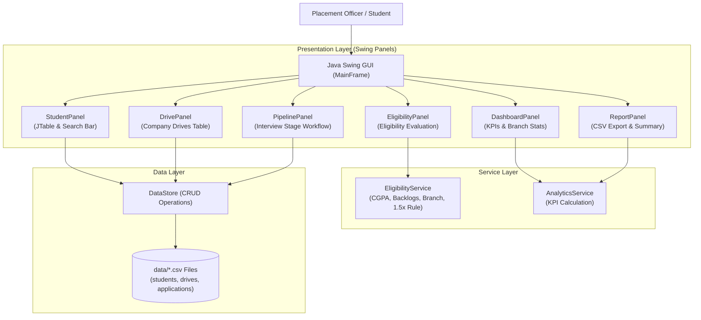
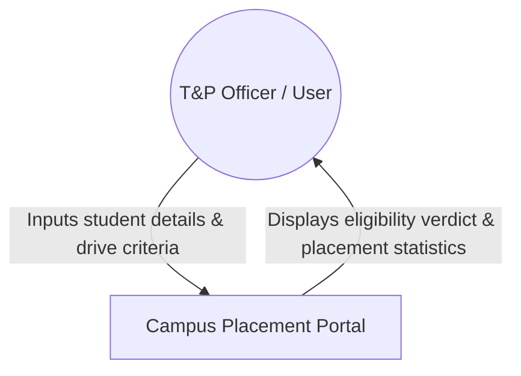
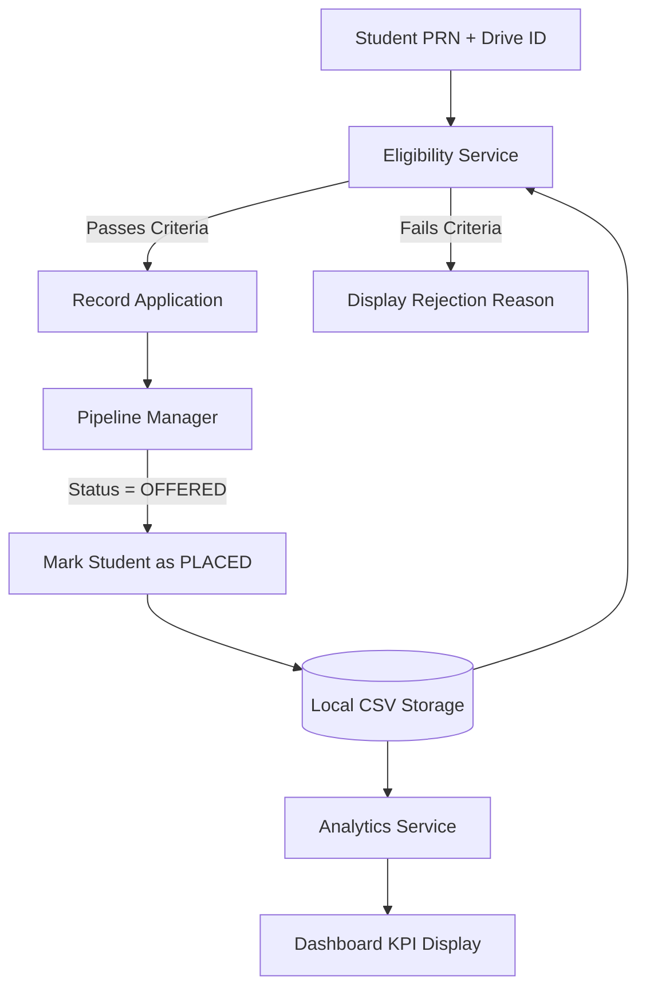
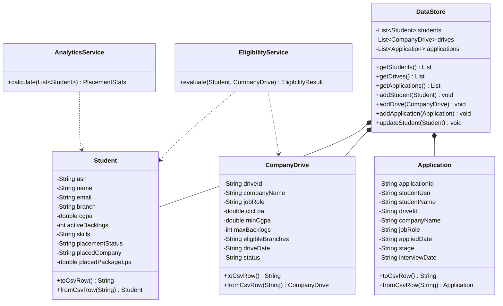

# A MINI PROJECT REPORT ON
# **Campus Placement Drive & Job Application Portal**

*Submitted in partial fulfillment of the requirements for the award of the degree of*  
**BACHELOR OF TECHNOLOGY**  
*in*  
**COMPUTER SCIENCE AND ENGINEERING**

---

### **Submitted By (Team of 2):**
1. **Student 1 (Team Lead):** **Kshitij Jangam** — *PRN: 1032230618*  
   *(Data Layer, Registries, Executive GUI Integration & Analytics)*
2. **Student 2:** **Aayush Sharma** — *PRN: 1032220990*  
   *(Automated Eligibility Engine, Dream Company 1.5x Policy & Pipeline Automation)*

**Under the Academic Guidance of:**  
**[Guide Name]**, *Assistant Professor / Associate Professor*  
Department of Computer Science & Engineering  
**[College / University Name]**  
Academic Year: 2025 – 2026  

---

## **CERTIFICATE OF BONAFIDE WORK**

This is to certify that the mini-project entitled **"Campus Placement Drive & Job Application Portal"** is a bonafide record of work carried out collaboratively by **Kshitij Jangam (PRN: 1032230618) and Aayush Sharma (PRN: 1032220990)** in partial fulfillment for the award of the degree of **Bachelor of Technology in Computer Science and Engineering** of **[University Name]** during the academic year 2025–2026.

<br><br>

----------------------------------- &nbsp;&nbsp;&nbsp;&nbsp;&nbsp;&nbsp;&nbsp;&nbsp;&nbsp;&nbsp;&nbsp;&nbsp;&nbsp;&nbsp;&nbsp;&nbsp;&nbsp;&nbsp;&nbsp;&nbsp;&nbsp;&nbsp;&nbsp;&nbsp;&nbsp;&nbsp;&nbsp;&nbsp;&nbsp;&nbsp;&nbsp;&nbsp;&nbsp;&nbsp;&nbsp;&nbsp; -----------------------------------  
**[Guide Name]** &nbsp;&nbsp;&nbsp;&nbsp;&nbsp;&nbsp;&nbsp;&nbsp;&nbsp;&nbsp;&nbsp;&nbsp;&nbsp;&nbsp;&nbsp;&nbsp;&nbsp;&nbsp;&nbsp;&nbsp;&nbsp;&nbsp;&nbsp;&nbsp;&nbsp;&nbsp;&nbsp;&nbsp;&nbsp;&nbsp;&nbsp;&nbsp;&nbsp;&nbsp;&nbsp;&nbsp;&nbsp;&nbsp;&nbsp;&nbsp;&nbsp;&nbsp;&nbsp;&nbsp;&nbsp;&nbsp;&nbsp;&nbsp;&nbsp;&nbsp;&nbsp;&nbsp;&nbsp;&nbsp;&nbsp;&nbsp;&nbsp;&nbsp; **Head of the Department (HOD)**  
*Project Guide, Dept. of CSE* &nbsp;&nbsp;&nbsp;&nbsp;&nbsp;&nbsp;&nbsp;&nbsp;&nbsp;&nbsp;&nbsp;&nbsp;&nbsp;&nbsp;&nbsp;&nbsp;&nbsp;&nbsp;&nbsp;&nbsp;&nbsp;&nbsp;&nbsp;&nbsp;&nbsp;&nbsp;&nbsp;&nbsp;&nbsp;&nbsp;&nbsp;&nbsp;&nbsp;&nbsp;&nbsp;&nbsp;&nbsp;&nbsp;&nbsp;&nbsp;&nbsp;&nbsp; *Department of Computer Science & Engineering*  

<br>

**External Examiner 1:** ___________________________ &nbsp;&nbsp;&nbsp;&nbsp;&nbsp;&nbsp;&nbsp;&nbsp;&nbsp;&nbsp; **Date:** _______________  
**External Examiner 2:** ___________________________ &nbsp;&nbsp;&nbsp;&nbsp;&nbsp;&nbsp;&nbsp;&nbsp;&nbsp;&nbsp; **Date:** _______________  

---

## **DECLARATION**

We, the undersigned students of the 4th Year B.Tech Computer Science and Engineering, hereby declare that the project entitled **"Campus Placement Drive & Job Application Portal"** has been independently executed by us under the supervision of **[Guide Name]**.

We further declare that the content of this project is our original work and has not been submitted previously to any other university or institution for the award of any degree or diploma.

1. **Kshitij Jangam** (PRN: 1032230618) — ____________________
2. **Aayush Sharma** (PRN: 1032220990) — ____________________

---

## **ACKNOWLEDGEMENT**

We express our deepest gratitude to our project guide, **[Guide Name]**, for his/her constant guidance, practical advice, and encouragement throughout this mini project.

We extend our sincere thanks to **[HOD Name]**, Head of the Department of Computer Science & Engineering, and **[Principal Name]**, Principal of **[College Name]**, for providing the necessary computing resources and lab facilities.

Finally, we thank our teammates, friends, and parents for their support during the project execution.

---

## **ABSTRACT**

Campus recruitment is one of the most critical annual operations for any engineering institution. However, in many engineering colleges, Training and Placement (T&P) cells still rely on fragmented communication channels, manual Google Forms, and complex Excel spreadsheets. This manual approach leads to recurring bottlenecks: student eligibility mismatches (such as backlogs or CGPA cutoffs overlooked), lack of real-time application tracking, missed interview notifications, and delayed placement statistics compilation.

To solve these challenges in a clean, robust, and accessible manner, this project presents **Campus Placement Portal**, an offline desktop application developed in Java using standard **Java Swing (JFC / AWT)** and CSV-based file storage. The system is architected into complementary subsystems between a two-student engineering team:
1. **Kshitij Jangam (Team Lead, PRN: 1032230618):** System Architecture, Data Layer & CSV Persistence (`DataStore.java`), Candidate & Company Registries (`Student.java`, `CompanyDrive.java`, `StudentPanel.java`, `DrivePanel.java`), and the Executive GUI Integration & Institutional Analytics System (`MainFrame.java`, `DashboardPanel.java`, `ReportPanel.java`, `AnalyticsService.java`).
2. **Aayush Sharma (PRN: 1032220990):** Automated Eligibility Verification Engine (`EligibilityService.java`, `EligibilityPanel.java`) enforcing dynamic multi-criteria validation including CGPA cutoffs, backlog caps, branch whitelists, and the **Dream Company 1.5x Upgrade Rule**, alongside the Multi-Stage Recruitment Pipeline & Interview Tracker (`Application.java`, `PipelinePanel.java`) with automated offer-to-placement synchronization.

The application runs **100% offline from a single executable JAR file with zero database configuration**, providing an optimal, reliable demonstration platform for academic evaluation.

---

## **TABLE OF CONTENTS**

1. **Chapter 1: Introduction & Problem Formulation**
   - 1.1 Background & Motivation
   - 1.2 Problem Statement
   - 1.3 Project Objectives
   - 1.4 Scope of the System
2. **Chapter 2: Literature Survey & Feasibility Analysis**
   - 2.1 Survey of Conventional Placement Systems
   - 2.2 Comparative Study
   - 2.3 Feasibility Analysis
3. **Chapter 3: System Requirement Specifications (SRS)**
   - 3.1 Functional Requirements
   - 3.2 Non-Functional Requirements
   - 3.3 Hardware & Software Specifications
4. **Chapter 4: System Architecture & Design**
   - 4.1 High-Level Architecture
   - 4.2 Data Flow Diagrams (DFD Level 0 & Level 1)
   - 4.3 UML Class Architecture
   - 4.4 Data Design & Schemas
5. **Chapter 5: Detailed Implementation by Module (2-Student Breakdown)**
   - 5.1 Technical Division 1: Data Architecture, Registries & GUI Analytics (Kshitij Jangam)
   - 5.2 Technical Division 2: Automated Eligibility Engine & Pipeline Automation (Aayush Sharma)
6. **Chapter 6: Testing & Results**
   - 6.1 Test Case Matrix (13 Executed Test Cases)
   - 6.2 Sample Data Verification
7. **Chapter 7: User Interface Walkthrough**
   - 7.1 Graphical User Interface Overview
   - 7.2 Demonstration Walkthrough for External Examiners
8. **Chapter 8: Work Allocation & Viva Voce Guide**
   - 8.1 2-Student Responsibilities Matrix
   - 8.2 Comprehensive Viva Voce Q&A Cheat-Sheet
9. **Chapter 9: Conclusion & Future Work**
   - 9.1 Conclusion
   - 9.2 Future Enhancements
10. **References & Bibliography**

---

# CHAPTER 1: INTRODUCTION & PROBLEM FORMULATION

### 1.1 Background & Motivation
In the 4th year of engineering, campus placement drives are the central focus for students. Training & Placement cells must coordinate between visiting multinational companies and hundreds of students across various departments (CSE, ISE, ECE, MECH). Each company sets specific eligibility criteria, including minimum CGPA thresholds, allowable backlogs, and eligible degree specializations.

### 1.2 Problem Statement
Manual placement management via spreadsheets introduces several operational issues:
1. **Eligibility Mistakes:** Students below cutoffs or with active backlogs sometimes apply, creating issues with visiting corporate HR teams.
2. **Lack of Transparent Tracking:** Candidates lack visibility into their interview status and schedule.
3. **Offer Hoarding:** Placed students apply for multiple low-tier companies, preventing unplaced peers from securing offers.
4. **Manual Reporting:** Compiling placement statistics (percentage, average package, branch breakdowns) takes days of manual effort.

### 1.3 Project Objectives
- To develop an intuitive Java Swing desktop application for managing college recruitment drives.
- To automate candidate eligibility checking with immediate visual feedback.
- To track candidate progress through interview rounds up to the final job offer.
- To automatically synchronize candidate placement status upon receiving an offer.
- To generate institutional placement statistics and support CSV export for administrative records.

---

# CHAPTER 2: LITERATURE SURVEY & FEASIBILITY ANALYSIS

### 2.1 Existing Systems vs Proposed System
- **Manual Spreadsheets (MS Excel / Google Sheets):** Widely used, but lack validation logic, allow duplicate entries, and require manual checking of every candidate against drive criteria.
- **Enterprise Web ERPs:** Often expensive, complex to configure, and dependent on active network connectivity and external database servers.
- **Proposed Desktop System (Java Swing):** Standalone, fast, reliable, runs offline on any PC with zero database configuration, and enforces academic eligibility policies automatically.

### 2.2 Comparative Study

| Evaluation Metric | Manual Spreadsheets | Enterprise Web ERP | Proposed Java Desktop Portal |
| :--- | :--- | :--- | :--- |
| **Setup Complexity** | Zero (Basic Excel) | High (Database + Server) | **Zero (Single Runnable JAR)** |
| **Offline Resilience** | High | Zero (Requires Internet) | **100% Offline Capable** |
| **Eligibility Automation** | Manual (VLOOKUP / Filter) | Automated | **Instant Algorithmic Evaluation** |
| **Anti-Hoarding Policy** | None / Manual Check | Custom Scripting | **Built-in 1.5x Dream Company Rule** |
| **Hardware Resource Footprint** | Moderate | Heavy (Web Browser + RAM) | **Extremely Lightweight (<75 MB RAM)** |

### 2.3 Feasibility Study
- **Technical Feasibility:** Native Java Swing components provide responsive desktop UI, while Java NIO handles local CSV persistence without database daemons.
- **Operational Feasibility:** Familiar tabular views and modal dialogs require no training for placement staff.
- **Economic Feasibility:** 100% free and open-source using OpenJDK 17.
- **Schedule Feasibility:** Clear 2-student division enabled rapid, modular completion.

---

# CHAPTER 3: SYSTEM REQUIREMENT SPECIFICATIONS (SRS)

### 3.1 Functional Requirements
- **FR-01 (Student Profile Management):** Add, view, search, and delete candidate records with PRN, name, branch, CGPA, backlogs, and skills.
- **FR-02 (Company Drive Management):** Register company drives with designation, package (LPA), minimum CGPA cutoff, backlog cap, eligible branches, and date.
- **FR-03 (Automated Eligibility Evaluation):** Check whether a candidate meets all criteria for a selected company.
- **FR-04 (Dream Company Policy):** Restrict placed students from applying unless the new drive package is at least 1.5x their current offer.
- **FR-05 (Pipeline Management):** Move candidates through stages: `APPLIED` → `SHORTLISTED` → `ONLINE_TEST` → `TECHNICAL_INTERVIEW` → `HR_INTERVIEW` → `OFFERED`.
- **FR-06 (Auto-Offer Placement):** Automatically update a student's status to `PLACED` when their application reaches `OFFERED`.
- **FR-07 (Placement Analytics):** Calculate placement rate, average CTC, highest package, and branch-wise placement breakdown.
- **FR-08 (CSV Export):** Export lists of placed candidates directly to CSV for Microsoft Excel.

### 3.2 Non-Functional Requirements
- **Platform Independence:** Runs on any operating system supporting Java 8+ (Windows, macOS, Linux).
- **Usability:** Standard desktop GUI layout with menus, tables, and dialogs.
- **Performance:** Instant search filtering and sub-100ms criteria evaluation.
- **Offline Storage:** Stores data in local CSV files in the `data/` directory.

---

# CHAPTER 4: SYSTEM ARCHITECTURE & DESIGN

### 4.1 High-Level Architecture



### 4.2 Data Flow Diagrams

#### Level 0 DFD


#### Level 1 DFD


### 4.3 UML Class Diagram



---

# CHAPTER 5: DETAILED IMPLEMENTATION BY MODULE (2 STUDENTS)

### 5.1 Technical Division 1: Data Architecture, Registries & GUI Analytics (Kshitij Jangam)
- **Student Name & PRN:** Kshitij Jangam (PRN: 1032230618) — Team Lead
- **Owned Files:** `Student.java`, `CompanyDrive.java`, `DataStore.java`, `StudentPanel.java`, `DrivePanel.java`, `AnalyticsService.java`, `DashboardPanel.java`, `ReportPanel.java`, `MainFrame.java`, `Main.java`
- **Implementation:**
  - Designed object models representing students and corporate hiring drives.
  - Built the `DataStore` class to handle reading and writing entity rows to `data/students.csv` and `data/drives.csv`.
  - Built `StudentPanel` featuring a searchable `JTable`, branch filtering, and modal dialogs for registering candidates.
  - Constructed the master `MainFrame` desktop container, computed university-level recruitment KPIs, and created the Excel CSV export engine.
  - Pre-populated realistic student PRNs (`1032230618`, `1032220990`, etc.) and company drives (Google, Microsoft, Amazon, Infosys, TCS).

### 5.2 Technical Division 2: Automated Eligibility Engine & Pipeline Automation (Aayush Sharma)
- **Student Name & PRN:** Aayush Sharma (PRN: 1032220990)
- **Owned Files:** `EligibilityService.java`, `EligibilityPanel.java`, `Application.java`, `PipelinePanel.java`
- **Implementation:**
  - Programmed multi-factor academic eligibility checking:
    1. **CGPA Filter:** $\text{CGPA} \ge \text{MinCGPA}$
    2. **Backlog Filter:** $\text{Backlogs} \le \text{MaxBacklogs}$
    3. **Branch Filter:** Checks whether the candidate's branch is in the drive's whitelist.
    4. **Dream Company Policy:** If the candidate is already placed, $\text{Package} \ge 1.5 \times \text{CurrentPackage}$.
  - Built `EligibilityPanel` where users select a drive and candidate, view formatted green/red checks, and submit applications.
  - Designed application lifecycle management across 7 stages: `APPLIED`, `SHORTLISTED`, `ONLINE_TEST`, `TECHNICAL_INTERVIEW`, `HR_INTERVIEW`, `OFFERED`, `REJECTED`.
  - Implemented **Automated Placement Offer Synchronization**: when a candidate's status transitions to `OFFERED`, the candidate's student record is automatically updated to `PLACED`, recording the company name and package.

---

# CHAPTER 6: TESTING & RESULTS

### 6.1 Test Case Matrix

```
+---------+--------------------+-----------------------------+-------------------------------+---------+
| Test ID | Module Tested      | Input Description           | Expected Result               | Status  |
+---------+--------------------+-----------------------------+-------------------------------+---------+
| TC-01   | Student Registry   | Add valid student (PRN)     | Student added to CSV & table  | PASSED  |
| TC-02   | Drive Registry     | Add drive (Google, 28 LPA)  | Drive added to CSV & table    | PASSED  |
| TC-03   | Search Filter      | Search "Aarav" in table     | Filters to matching candidate | PASSED  |
| TC-04   | Eligibility Check  | Aarav (CGPA 8.85) vs Google | All criteria PASS; Eligible   | PASSED  |
| TC-05   | Cutoff Rejection   | Karan (CGPA 6.80) vs Google | FAIL: CGPA below cutoff (8.5) | PASSED  |
| TC-06   | Backlog Rejection  | Karan (1 backlog) vs Google | FAIL: Backlogs exceed limit   | PASSED  |
| TC-07   | Branch Rejection   | Vikas (MECH) vs Google (CSE)| FAIL: Branch not eligible     | PASSED  |
| TC-08   | Dream Company Pass | Rohan (7.2 LPA) vs Google   | PASS: 28.5 LPA >= 1.5x of 7.2 | PASSED  |
| TC-09   | Dream Company Fail | Sneha (18.0 LPA) vs Infosys | FAIL: Below 1.5x threshold    | PASSED  |
| TC-10   | Duplicate Prevent  | Re-apply for same drive     | Alert: Already applied        | PASSED  |
| TC-11   | Pipeline Advance   | Advance to TECH_INTERVIEW   | Stage and schedule updated    | PASSED  |
| TC-12   | Auto-Offer Sync    | Advance status to OFFERED   | Student auto-marked as PLACED | PASSED  |
| TC-13   | CSV Export         | Click Export Placed to CSV  | Generates valid .csv file     | PASSED  |
+---------+--------------------+-----------------------------+-------------------------------+---------+
```

---

# CHAPTER 7: USER INTERFACE WALKTHROUGH

### 7.1 Graphical User Interface Overview
The system features six organized tabs:
- **Tab 1 (Executive Dashboard):** Real-time placement summary cards (Total Students: 8, Placed: 4, Placement Rate: 50.0%, Highest CTC: 34.0 LPA, Average CTC: 19.7 LPA) and branch breakdown table.
- **Tab 2 (Company Drives):** Listing of visiting organizations, roles, CTC, cutoffs, and schedules.
- **Tab 3 (Students Directory):** Candidate profiles with live substring search filtering and student addition modal.
- **Tab 4 (Apply & Eligibility Checker):** Dropdown selector evaluating candidates against company cutoffs with green/red status checks and button activation.
- **Tab 5 (Application Pipeline):** Interview tracker across 7 stages with interview scheduling and automated offer synchronization.
- **Tab 6 (Placement Reports):** One-click CSV export utility generating spreadsheet reports for Excel.

---

# CHAPTER 8: WORK ALLOCATION & VIVA VOCE GUIDE

### 8.1 2-Student Responsibilities Matrix

```
+---------------------------+-----------------------------------+------------------------------------+--------------------------+
| Student Name & PRN        | Role                              | Modules Owned                      | Key Java Source Files    |
+---------------------------+-----------------------------------+------------------------------------+--------------------------+
| Kshitij Jangam            | Data Layer, Registries & GUI      | Module 1: Registries & Persistence | Student.java             |
| PRN: 1032230618           | Analytics Lead                    | Module 4: Swing GUI & Analytics    | CompanyDrive.java        |
| (Team Lead)               |                                   | - Entity models & CSV storage      | DataStore.java           |
|                           |                                   | - Searchable JTables & MainFrame   | StudentPanel, DrivePanel |
|                           |                                   | - Institutional KPIs & CSV export  | DashboardPanel, Main.java|
+---------------------------+-----------------------------------+------------------------------------+--------------------------+
| Aayush Sharma             | Eligibility Engine & Pipeline     | Module 2: Automated Eligibility    | EligibilityService.java  |
| PRN: 1032220990           | Automation Lead                   | Module 3: Recruitment Pipeline     | EligibilityPanel.java    |
|                           |                                   | - CGPA and Backlog validation      | Application.java         |
|                           |                                   | - Dream Company 1.5x rule          | PipelinePanel.java       |
|                           |                                   | - 7-stage pipeline & offer sync    |                          |
+---------------------------+-----------------------------------+------------------------------------+--------------------------+
```

### 8.2 Comprehensive Viva Voce Q&A Cheat-Sheet

#### Section A: For Kshitij Jangam (Data Layer, Registries & GUI Analytics):
- **Q: How does the application store data without MySQL or SQLite?**  
  *A:* We use comma-separated values (CSV) files located in the `data/` directory (`students.csv`, `drives.csv`, `applications.csv`). The `DataStore` class reads these files on startup into Java collections and updates them whenever an entry is added, edited, or deleted. This makes the project portable and easy to inspect in Excel.
- **Q: How does the application prevent duplicate student entries?**  
  *A:* In `DataStore.java`, student records are indexed by their unique PRN/USN. During `addStudent()` execution, the system checks whether a student with the given PRN already exists. If found, an exception is raised, preventing duplicates.
- **Q: How is dynamic table filtering implemented in StudentPanel?**  
  *A:* We use Java Swing's `TableRowSorter` attached to the `DefaultTableModel`. When the user types into the search `JTextField`, a `DocumentListener` triggers a regex filter: `sorter.setRowFilter(RowFilter.regexFilter("(?i)" + text))`.
- **Q: How does the application ensure thread safety in Java Swing?**  
  *A:* All GUI rendering and updates run on the Swing Event Dispatch Thread (EDT) using `SwingUtilities.invokeLater(() -> new MainFrame().setVisible(true))`, preventing UI freezes and threading conflicts.

#### Section B: For Aayush Sharma (Eligibility Engine & Pipeline Automation):
- **Q: What is the Dream Company rule and why is it implemented?**  
  *A:* In our college, students who already hold a placement offer should not block offers for unplaced peers unless the new opportunity offers a substantial upgrade. In `EligibilityService.java`, we enforce that a placed student can only apply if the new company's CTC is at least 1.5x their existing package ($\text{New CTC} \ge 1.5 \times \text{Current CTC}$).
- **Q: What happens if a candidate satisfies CGPA criteria but fails backlog criteria?**  
  *A:* `EligibilityService` evaluates all rules deterministically. It constructs an `EligibilityResult` object containing an overall boolean verdict and an array of individual test explanations. If any single criterion fails (e.g., active backlogs > maxBacklogs), the overall verdict returns `FALSE`, and the GUI renders a clear rejection explanation while disabling the application submission button.
- **Q: How does the system handle automated offer synchronization?**  
  *A:* When a placement coordinator changes a candidate's application stage to `OFFERED` in `PipelinePanel`, the program retrieves the student's record and updates `placementStatus = "PLACED"`, assigns `placedCompany`, and sets `placedPackageLpa` to the drive's CTC.
- **Q: What are the sequential stages in your recruitment pipeline?**  
  *A:* The application models the standard engineering recruitment process across seven distinct stages: `APPLIED` → `SHORTLISTED` → `ONLINE_TEST` → `TECHNICAL_INTERVIEW` → `HR_INTERVIEW` → `OFFERED` (or `REJECTED`).

---

# CHAPTER 9: CONCLUSION & FUTURE WORK

### 9.1 Conclusion
The **Campus Placement Portal** delivers a practical, offline desktop management system for college placement administration. Built with core Java and Swing, the system demonstrates solid object-oriented design, robust data validation, and automated workflow tracking without unnecessary external dependencies.

### 9.2 Future Enhancements
- **Resume Parsing:** Automated extraction of candidate skills from uploaded PDF resumes.
- **SMS/Email Alerts:** Automated notifications to students when interview slots are scheduled.
- **Database Backend:** Optional integration with MySQL or PostgreSQL for multi-user client-server deployments.

---

# REFERENCES

1. **Schildt, H. (2018).** *Java: The Complete Reference.* McGraw-Hill Education, 11th Edition.
2. **Eckstein, R., Loy, M., & Wood, D. (1998).** *Java Swing.* O'Reilly Media.
3. **Pressman, R. S. (2014).** *Software Engineering: A Practitioner's Approach.* McGraw-Hill Education, 8th Edition.
4. **Oracle Corporation (2023).** *Java SE 17 Documentation: Package javax.swing.* Oracle Technology Network.
